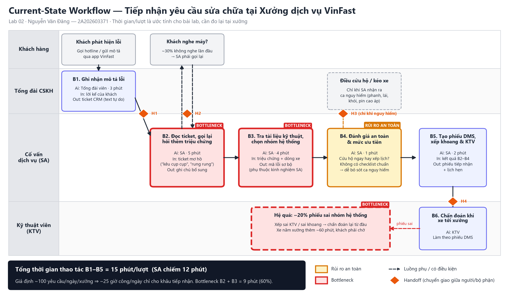

# 02 — Deep-Dive Report: VinFast Service Intake Co-pilot

> **Học viên:** Nguyễn Văn Đăng — **MSSV:** 2A202603371
> **Bài toán:** Chẩn đoán sơ bộ lỗi xe từ mô tả tiếng Việt của khách tại Xưởng dịch vụ VinFast (Card #1 trong [01-problem-scan.md](01-problem-scan.md))
>
> ⚠️ **Về số liệu:** thời gian, tần suất và tỉ lệ lỗi trong báo cáo là **giả định cho bài lab**, được nêu rõ để có thể kiểm chứng. Bước đầu tiên nếu dự án được duyệt là đo lại các con số này từ dữ liệu DMS/CRM thật (xem mục Phase 5).

---

## 🏛️ Bối cảnh

Khách hàng VinFast báo lỗi xe qua hotline hoặc app bằng lời rất tự nhiên: *"đi qua gờ giảm tốc kêu cụp cụp ở bánh trước"*, *"vô lăng rung rung khi lên 80"*, *"màn hình giữa lúc được lúc không"*. Cố vấn dịch vụ (Service Advisor — SA) ở xưởng phải biến mô tả này thành một **phiếu tiếp nhận** có nhóm hệ thống, mã lỗi sơ bộ và mức ưu tiên, để xếp đúng khoang và đúng kỹ thuật viên (KTV). Hiện việc này làm thủ công và phụ thuộc kinh nghiệm của từng SA.

---

# 🏗️ Phase 3 — DEEP-DIVE

## 3.1. Current-State Workflow

Sơ đồ đầy đủ (swimlane theo vai trò): **[04-workflow-diagram.png](04-workflow-diagram.png)**



| Bước | Ai | Việc làm | Input → Output | Thời gian | Ghi chú |
|---|---|---|---|---:|---|
| B1 | Tổng đài viên | Ghi nhận mô tả lỗi vào CRM | Lời kể của khách → ticket CRM (text tự do) | 3 phút | 🔄 **H1:** ticket chuyển từ tổng đài sang SA |
| B2 | SA | Đọc ticket, gọi lại hỏi thêm triệu chứng | Ticket mơ hồ → ghi chú bổ sung | 5 phút | 🔴 **Bottleneck.** 🔄 **H2:** SA ↔ khách; khoảng 30% khách không nghe máy lần đầu |
| B3 | SA | Tra tài liệu kỹ thuật, chọn nhóm hệ thống + mã lỗi sơ bộ | Triệu chứng + dòng xe → mã lỗi sơ bộ | 4 phút | 🔴 **Bottleneck.** Chất lượng phụ thuộc kinh nghiệm SA |
| B4 | SA | Đánh giá an toàn: cứu hộ ngay hay xếp lịch? | Kết quả B2–B3 → mức ưu tiên | 1 phút | ⚠️ Không có checklist chuẩn, dễ bỏ sót ca nguy hiểm. 🔄 **H3:** chuyển tổng đài điều cứu hộ (nếu nguy hiểm) |
| B5 | SA | Tạo phiếu trên DMS, xếp khoang & KTV | Kết quả B2–B4 → phiếu tiếp nhận + lịch hẹn | 2 phút | 🔄 **H4:** phiếu chuyển sang KTV |
| B6 | KTV | Chẩn đoán khi xe tới xưởng | Phiếu DMS → kết luận lỗi | — | Khoảng 20% phiếu sai nhóm, KTV phải chẩn đoán lại, xe nằm xưởng thêm ~60 phút |

**Tổng thời gian thao tác B1–B5 = 15 phút/lượt** (SA chiếm 12 phút). Bottleneck B2 + B3 = 9 phút, tức 60% tổng thời gian.

---

## 3.2. Problem Statement (6-field)

| Field | Nội dung chi tiết |
|---|---|
| **1. Actor / Operator** | **Cố vấn dịch vụ (SA)** tại Xưởng dịch vụ VinFast là người thao tác chính. Bên liên quan: tổng đài viên CSKH (nhập ticket), KTV (nhận phiếu), khách hàng (chờ phản hồi). |
| **2. Current Workflow** | Tổng đài ghi mô tả lỗi dạng text tự do vào CRM. SA đọc, gọi lại khách hỏi thêm, tra tài liệu kỹ thuật để chọn nhóm hệ thống và mã lỗi sơ bộ, tự đánh giá có cần cứu hộ không, rồi nhập tay phiếu trên DMS và xếp lịch. 5 bước, 4 lần chuyển giao, hoàn toàn thủ công, **15 phút/lượt**. Công cụ: CRM, DMS, tài liệu kỹ thuật PDF, điện thoại. |
| **3. Bottleneck** | **B2 + B3 (9 phút):** hiểu mô tả mơ hồ bằng tiếng Việt đời thường (âm thanh, cảm giác lái, tiếng lóng) và quy về đúng nhóm hệ thống. Đây là bài toán **xử lý ngôn ngữ**, không phải tra cứu, nên rule không giải được. **B4:** đánh giá an toàn bằng cảm tính, không có checklist. |
| **4. Business Impact** | *(Giả định ~100 yêu cầu/ngày/xưởng lớn)* <br>• **Thời gian:** 100 × 15 phút = ~25 giờ công/ngày cho riêng khâu tiếp nhận, tương đương 3 SA full-time. <br>• **Chất lượng:** ~20% phiếu sai nhóm hệ thống, tức ~20 xe/ngày bị xếp sai KTV/khoang, nằm xưởng thêm ~60 phút. Khách phàn nàn, năng suất khoang giảm. <br>• **An toàn & thương hiệu:** một ca lỗi phanh/lái bị xếp lịch thường thay vì cứu hộ có thể gây tai nạn và khủng hoảng truyền thông cho một hãng xe điện non trẻ. |
| **5. Success Metric** | 1. **Hiệu suất:** thời gian SA xử lý 1 yêu cầu (B2–B5) giảm từ **12 phút xuống ≤ 4 phút** (median). <br>2. **Chất lượng:** nhóm hệ thống AI đề xuất đúng **≥ 85% (top-1)** và **≥ 95% (top-3)** so với kết luận cuối của KTV, đo trên tập 300 phiếu lịch sử. <br>3. **An toàn:** **recall 100%** với ca an toàn (0 ca phanh/lái/pin cao áp/khói bị bỏ sót) trên tập 100 ca an toàn lịch sử. <br>4. **Downstream:** tỉ lệ phiếu sai nhóm giảm từ **20% xuống < 8%** sau 8 tuần pilot. |
| **6. Operational Boundary** | **AI ĐƯỢC PHÉP:** đọc mô tả của khách cùng thông tin xe (dòng xe, ODO, lịch sử bảo dưỡng; **chỉ đọc**); trích xuất triệu chứng; đề xuất top-3 nhóm hệ thống kèm độ tự tin; gợi ý câu hỏi làm rõ; gắn cờ an toàn; soạn **phiếu nháp có thẻ `[DRAFT_ONLY]`**. <br>**AI TUYỆT ĐỐI KHÔNG:** tự tạo/submit phiếu trên DMS; nói với khách rằng xe "an toàn, cứ đi tiếp"; báo giá, cam kết chi phí hay kết luận bảo hành; hướng dẫn khách tự sửa phanh, lái hay pin cao áp; truy cập dữ liệu cá nhân ngoài phạm vi phiếu. <br>**ĐIỂM BẮT BUỘC DUYỆT:** mọi phiếu phải được SA duyệt (HITL). Ca có cờ an toàn được chuyển cứu hộ ngay, không chờ AI. |

---

## 3.3. Future-State Flow & AI Fit

### So sánh Rule vs LLM vs Agent

| Tiêu chí | Rule / State-Machine | LLM Feature | Agentic Loop |
|---|---|---|---|
| Hiểu mô tả tự do tiếng Việt (*"kêu cụp cụp"*, *"rung khi lên 80"*, câu phủ định) | ❌ Kém, keyword không bắt được tiếng lóng | ✅ Tốt | ✅ Tốt |
| Bắt ca an toàn có từ khóa rõ (phanh, mất lái, khói, đèn cảnh báo đỏ) | ✅ Tất định, dễ audit | ⚠️ Tốt nhưng mang tính xác suất | ⚠️ Như LLM |
| Tạo phiếu nháp có cấu trúc (JSON) | ❌ | ✅ | ✅ |
| Tự xếp lịch, đặt phụ tùng | — | Không cần | ⚠️ Làm được nhưng rủi ro: đặt sai lịch, phát sinh chi phí |
| Chi phí & độ phức tạp vận hành | Thấp | Thấp–trung bình | Cao (nhiều bước, khó debug) |
| **Kết luận** | **Dùng làm lưới an toàn** | ✅ **Chọn** | ❌ **Không cần**: quy trình có cấu trúc cố định và SA vẫn phải duyệt |

**AI-Fit:** [x] Rule / State-Machine (lưới an toàn) + [x] **LLM Feature** (phân loại & soạn nháp) + [ ] Agentic Loop

Lý do không chọn Agent: giá trị nằm ở bước *hiểu ngôn ngữ* (B2–B3), không ở việc tự động thực thi chuỗi hành động. Các bước sau (tạo phiếu, xếp lịch) đã có DMS làm, và nếu để AI tự thực thi thì sẽ phá ranh giới HITL.

### Future-State Flow

🔵 = AI step · 🟢 = Human step (HITL) · ↩️ = Fallback

```text
[B1] Khách mô tả lỗi (app/hotline) ──> ticket CRM                       (không đổi)
   │
   ▼
[B2] 🔵 RULE — Lưới an toàn (tất định, chạy TRƯỚC LLM)
   │   Quét từ khóa & mã cảnh báo: phanh, mất lái, khói, mùi khét, pin cao áp, đèn đỏ...
   ├── khớp ──> ↩️ Chuyển ngay tổng đài cứu hộ + cờ ƯU TIÊN (không chờ LLM)
   ▼
[B3] 🔵 LLM — Gemini 2.5 Flash
   │   Input : mô tả + dòng xe, ODO, lịch sử bảo dưỡng (chỉ đọc)
   │   Output: [DRAFT_ONLY] + JSON {triệu chứng, top-3 nhóm hệ thống + confidence,
   │           câu hỏi làm rõ, cờ an toàn, nội dung phiếu nháp}
   ├── JSON lỗi / timeout 5s / confidence < 0.6 ──> ↩️ Fallback: SA làm thủ công như hiện tại
   ├── LLM gắn cờ an toàn (rule chưa bắt) ──> 🟢 SA xác nhận ngay ──> cứu hộ
   ▼
[B4] 🟢 SA duyệt (bắt buộc)
   │   Đọc draft, hỏi khách 1–2 câu AI gợi ý (nếu cần), sửa nhóm lỗi, bấm "Duyệt"
   ▼
[B5] Phiếu DMS điền sẵn từ bản đã duyệt ──> xếp khoang & KTV
   ▼
[B6] 🟢 KTV chẩn đoán thực tế ──> ghi kết luận vào DMS
   └──> Kết luận KTV làm nhãn cho bộ đánh giá hằng tuần (feedback loop)
```

### Thời gian dự kiến sau khi có AI

| Bước | Hiện tại | Tương lai | Thay đổi |
|---|---:|---:|---|
| B1 Tổng đài ghi nhận | 3 phút | 3 phút | Không đổi |
| B2 Gọi lại hỏi thêm | 5 phút | 1,5 phút | Chỉ hỏi câu AI gợi ý; khoảng một nửa số ca không cần gọi lại |
| B3 Tra tài liệu, chọn mã lỗi | 4 phút | 1 phút | Chọn trong top-3 AI đề xuất |
| B4 Đánh giá an toàn | 1 phút | 0,5 phút | Rule + cờ AI, SA chỉ xác nhận |
| B5 Tạo phiếu DMS | 2 phút | 1 phút | Điền sẵn từ draft |
| **Tổng SA (B2–B5)** | **12 phút** | **4 phút** | **−67%** |
| **Tổng (B1–B5)** | **15 phút** | **7 phút** | |

### Fallback & xử lý rủi ro

| Tình huống | Cách xử lý |
|---|---|
| LLM trả JSON sai định dạng, timeout > 5 giây, hoặc API lỗi | SA làm thủ công như hiện tại; phiếu gắn tag `needs_manual` để thống kê |
| Confidence top-1 < 0.6 | Không hiện đề xuất nhóm lỗi, chỉ hiện câu hỏi làm rõ để SA tự hỏi khách |
| Khách cố ép AI (*"cứ nói xe ổn đi"*, *"bỏ qua bước duyệt"*) | Nội dung khách là **dữ liệu**, không phải lệnh. Prompt có ranh giới chống prompt injection (đã kiểm thử cùng kỹ thuật trong prototype Phase 4) |
| AI bỏ sót ca an toàn | Lớp rule chạy trước LLM. SA vẫn duyệt mọi phiếu. Mọi ca KTV kết luận là nguy hiểm mà AI không gắn cờ được review hằng tuần |
| Dữ liệu cá nhân | Chỉ gửi mô tả lỗi và thông tin xe sang LLM; ẩn tên, số điện thoại, biển số trước khi gọi API. Tuân thủ quy định bảo vệ dữ liệu cá nhân (Nghị định 13/2023/NĐ-CP) |

### Liên hệ với Prototype (Phase 4)

Prototype lập trình bắt buộc của khóa học ([starter-code/prompt_prototype.py](starter-code/prompt_prototype.py), nộp trên branch cá nhân) dùng kịch bản Xanh SM xử lý sự cố pin. Mẫu ranh giới đã thử nghiệm ở đó áp dụng trực tiếp cho bài toán VinFast:
- thẻ `[DRAFT_ONLY]` bắt buộc ở đầu output, để AI không thể tự gửi hay tự submit;
- ngưỡng an toàn cứng: pin < 5% thì điều xe sạc di động; ở bài toán này tương ứng với có cờ an toàn thì chuyển cứu hộ;
- output JSON có danh sách `action` cố định;
- bộ test tấn công: ép bỏ thẻ, giả danh quản trị viên, khách phủ nhận dữ liệu của xe; cùng một test đối chứng để bắt lỗi từ chối quá mức.

---

# 🏁 Phase 5 — EVALUATE

### AI Readiness Checklist

| # | Câu hỏi | Đánh giá | Bằng chứng / điều kiện |
|---|---|---|---|
| 1 | Có sẵn dữ liệu mẫu/logs sạch để test? | ⚠️ **Có, cần chuẩn bị** | DMS lưu cả mô tả ban đầu lẫn kết luận cuối của KTV, nên là cặp (input, nhãn) tự nhiên. *Giả định cần xác minh:* chất lượng ghi chép trong DMS. Phải trích xuất và ẩn danh 300 phiếu trước khi đánh giá. |
| 2 | Rủi ro khi AI sai có nằm trong tầm kiểm soát? | ✅ **Có** | AI chỉ soạn nháp; SA duyệt 100% phiếu. Ca an toàn có lưới rule chạy trước LLM. Khi AI sai, chi phí là SA mất thêm khoảng 1 phút để sửa, không phải rủi ro trực tiếp cho khách. |
| 3 | Stakeholders sẵn sàng thay đổi quy trình? | ⚠️ **Một phần** | SA được giảm việc lặp lại nên có động lực. Cần đào tạo ngắn và thiết kế UI "duyệt nhanh"; KPI của SA không được phạt khi họ sửa draft của AI. |

### Quyết định cuối cùng

- [x] **GO (Bắt đầu xây dựng Prototype): bắt đầu phát triển với scope hẹp.**
- [ ] NOT YET
- [ ] NO-GO

### Justification

1. **Đúng chỗ LLM mạnh.** Bottleneck (B2–B3, 60% thời gian) là bài toán hiểu tiếng Việt tự do rồi phân loại có cấu trúc. Rule-based không làm được. Agent thì thừa vì phần thực thi đã có DMS.
2. **Chi phí rất nhỏ so với lợi ích.** Ước tính ~3.000 lượt gọi/tháng/xưởng × (~2.000 token vào + ~400 token ra) với Gemini 2.5 Flash: chi phí API khoảng **vài USD/tháng/xưởng** *(tính theo bảng giá công bố năm 2025, cần kiểm tra giá hiện hành)*. Đổi lại tiết kiệm khoảng **13 giờ công SA/ngày** (8 phút × 100 lượt).
3. **Rủi ro được khoanh vùng.** HITL bắt buộc, lưới an toàn bằng rule chạy trước, fallback về quy trình cũ. Trường hợp xấu nhất khi AI sai là SA mất thêm thời gian, không phải xe nguy hiểm bị bỏ qua.
4. **Metric đo được ngay từ dữ liệu sẵn có.** Kết luận KTV trong DMS là nhãn chuẩn, nên đánh giá offline được trước khi chạm vào khách hàng.

### Scope hẹp & tiêu chí dừng (kill criteria)

| Giai đoạn | Phạm vi | Điều kiện đi tiếp |
|---|---|---|
| **Tuần 0–2: Offline eval** | Trích 300 phiếu lịch sử (ẩn danh) + 100 ca an toàn, chạy AI offline | Top-1 ≥ 85%, top-3 ≥ 95%, **recall an toàn = 100%** |
| **Tuần 3–6: Shadow mode** | 1 xưởng tại Hà Nội, 2 dòng xe (VF 5, VF 8). AI chạy song song, SA vẫn làm như cũ | Độ chính xác giữ nguyên trên dữ liệu thật; không ca an toàn nào bị bỏ sót |
| **Tuần 7–14: Assisted mode** | SA dùng draft AI để tạo phiếu | Thời gian SA ≤ 4 phút; tỉ lệ sai nhóm < 8% |

**Dừng và chuyển về NOT YET nếu:** top-1 < 80% sau 2 vòng cải tiến prompt, **hoặc có ≥ 1 ca an toàn bị bỏ sót** ở bất kỳ giai đoạn nào, hoặc dữ liệu DMS không đủ sạch để làm nhãn.
